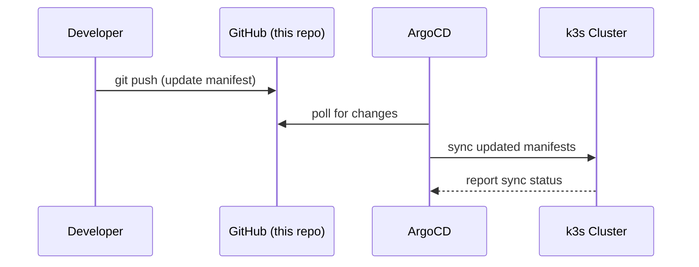

# hetzner-gitops


K3s cluster on Hetzner Cloud, managed with ArgoCD using the App of Apps pattern.

## Prerequisites

- k3s cluster running on Hetzner Cloud
- ArgoCD installed and accessible ([bootstrap repo](https://github.com/zimasu/hetzner-infra))

## Installation

```bash
kubectl apply -f root-application.yaml
```

ArgoCD will pick up all apps in `apps/` and sync them to the cluster automatically.

## Structure

```
.
├── root-application.yaml   # App of Apps entry point
├── apps/                   # ArgoCD Application manifests
├── manifests/              # Kubernetes manifests per service
└── charts/                 # Custom Helm charts (e.g. NocoDB ARM64)
```

## Stack

[k3s](https://k3s.io) · [ArgoCD](https://argo-cd.readthedocs.io) · [ingress-nginx](https://kubernetes.github.io/ingress-nginx/) · [cert-manager](https://cert-manager.io) · [Helm](https://helm.sh) · [GitHub Actions](https://github.com/features/actions)

## Services

[Gitea](https://gitea.io) · [n8n](https://n8n.io) · [NocoDB](https://nocodb.com) · [Open WebUI](https://github.com/open-webui/open-webui) · [ntfy](https://ntfy.sh) · [Anki](https://apps.ankiweb.net) · [MkDocs](https://www.mkdocs.org) · [BookStack](https://www.bookstackapp.com)

## How it works


