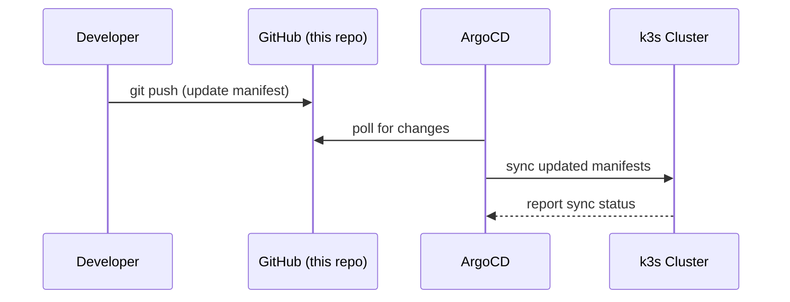

# hetzner-gitops
K3s cluster running on Hetzner Cloud and managed with ArgoCD.
## Motivation
Managing self-hosted services manually became error-prone. This repo makes every deployment reproducible and auditable via Git.
## Structure
App-of-Apps: `root-application.yaml` syncs `apps/`.
Each file in `apps/` points ArgoCD at a path in `manifests/`.

    apps/       ArgoCD Application manifests
    manifests/  Kubernetes manifests per service
    charts/     Custom Helm charts (NocoDB, ARM64)

## Stack
- k3s
- ArgoCD
- ingress-nginx
- cert-manager
- Helm
- GitHub Actions

## Services
- Gitea
- n8n
- NocoDB
- Open WebUI
- ntfy
- Anki
- MkDocs
- BookStack

## How it works

This repo follows the **App of Apps** GitOps pattern.  
`root-application.yaml` registers every app in `apps/` with ArgoCD.  
ArgoCD continuously polls this repo and syncs any changes to the k3s cluster automatically.

